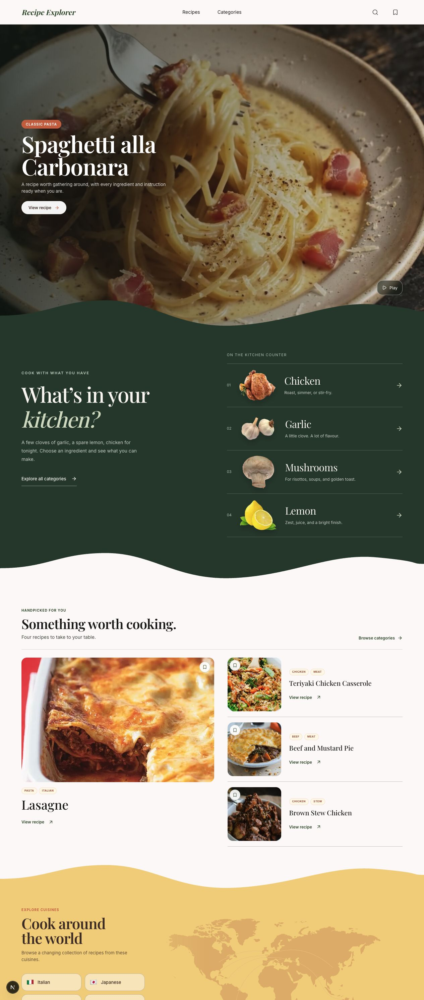
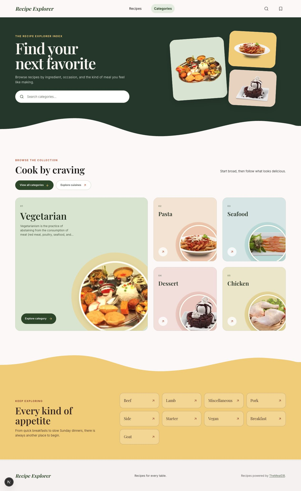

# 🍽️ Recipe Explorer

Developed by Gisela Rosibel Scarpin.

A concept recipe discovery application built as a frontend portfolio project. Explore dishes by category, cuisine, or ingredient, search for recipes, and save favorites in your browser.

## 📥 Clone and run locally

Prerequisites: Node.js compatible with Next.js 16 and pnpm 11, and **pnpm 11.1.2** (the version pinned in `package.json`).

```bash
git clone https://github.com/giselars/recipe-explorer.git
cd recipe-explorer
pnpm install
pnpm dev
```

Open [http://localhost:3000](http://localhost:3000).

No environment variables are required for the current setup. The provider uses TheMealDB's public V1 development key. An internet connection is needed to load recipe data, remote media, and Google Fonts during the initial build.

To run a production build locally:

```bash
pnpm build
pnpm start
```

## 📸 Screenshots

**Home — featured recipe and discovery sections**



**Categories — browse and search the collection**



## 🔧 Solution overview

- Discover a curated selection of recipes on the home page.
- Browse categories, cuisines, and recipes featuring a selected ingredient.
- Search recipes by name, with the query represented in the URL.
- Read ingredients, measures, and preparation instructions on recipe detail pages.
- Save and remove favorites using browser `localStorage`, without an account.
- Browse responsive layouts with loading, empty, error, and not-found states.

Recipe data and recipe/category images are provided by **[TheMealDB](https://www.themealdb.com/)**. See the [official API documentation](https://www.themealdb.com/docs_api_guide.php) for endpoints and usage details.

The home collection is curated rather than a feed of the latest recipes. Recipe information reflects the provider's available data; nutrition, cooking times, and verified dietary or allergen classifications are not supplied by this application.

## 🏗️ Proposed architecture

The application follows a layered architecture that keeps the external recipe API behind an application-owned provider contract:

```text
Pages and UI components
        ↓
Recipe service → RecipeProvider contract
        ↓
TheMealDB provider and domain mappers
        ↓
TheMealDB API
```

The provider validates responses and maps external fields into internal recipe models. Pages load data through the recipe service, while UI components consume those models without depending on TheMealDB field names.

Server Components handle initial data loading and page composition. Client Components support interactive browsing, favorites, and browser media controls. Favorites use React Context with a local storage-backed store; no application database is required.

## 📂 Project structure

The repository contains the application at its root:

```text
recipe-explorer/
├── docs/screenshots/        # README screenshots
├── public/                 # Static images and illustrations
├── src/
│   ├── app/                # App Router pages, layouts, and route states
│   │   ├── _components/    # Home-specific components
│   │   ├── categories/     # Category browsing and recipe lists
│   │   ├── cuisines/       # Cuisine browsing and recipe lists
│   │   ├── favorites/      # Locally saved recipes
│   │   ├── ingredients/    # Recipes by ingredient
│   │   ├── recipes/        # Recipe detail pages
│   │   └── search/         # Recipe-name search
│   ├── components/         # Shared UI and layout components
│   ├── features/favorites/ # Favorites state and persistence
│   ├── lib/recipes/        # Provider contract, service, and API adapter
│   ├── models/             # Internal domain models
│   └── styles/             # Shared Sass helpers
└── package.json            # Dependencies and scripts
```

Route-specific components are colocated in `_components/` directories. Component styles use adjacent `.module.scss` files; global base styles and design tokens live in `src/app/globals.scss`.

## 🛠️ Technologies used

| Technology                   | Purpose                                                   |
| ---------------------------- | --------------------------------------------------------- |
| Next.js 16 · App Router      | Routing, Server Components, and server-side data fetching |
| React 19                     | UI composition and interactive features                   |
| TypeScript · strict mode     | Typed domain models and application code                  |
| Sass Modules                 | Scoped component styles and responsive layouts            |
| `next/image` and `next/font` | Image optimization and font loading                       |
| Lucide React                 | Interface icons                                           |
| TheMealDB V1                 | Recipe and category data                                  |
| Vitest                       | Unit and component rendering tests                        |
| ESLint and Prettier          | Code quality and formatting                               |
| pnpm                         | Dependency management and project commands                |

## 🧪 Tests and quality checks

```bash
pnpm test
pnpm lint
pnpm typecheck
pnpm format:check
```

Tests are colocated with the code they cover:

- **Domain mappers:** recipe normalization, ingredient/measure pairing, and missing or invalid fields.
- **TheMealDB provider:** request handling, search normalization, empty responses, and provider failures using mocked API responses.
- **Recipe collection:** pagination logic and server-rendered collection markup.

Run `pnpm build` to verify the production build. The current suite does not include browser end-to-end tests.
